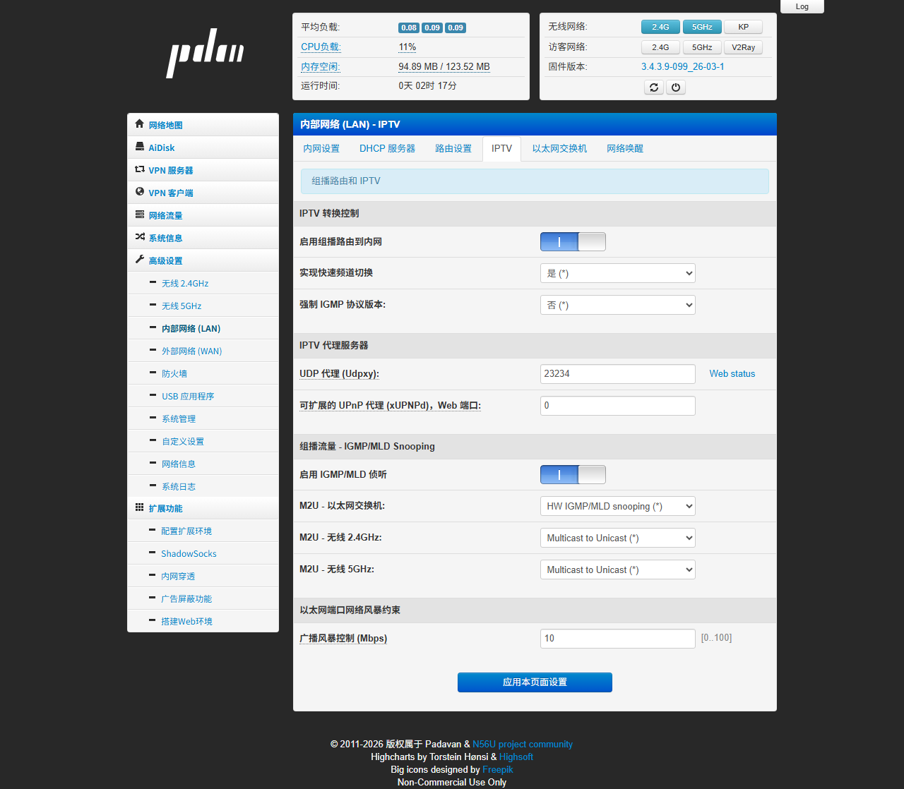
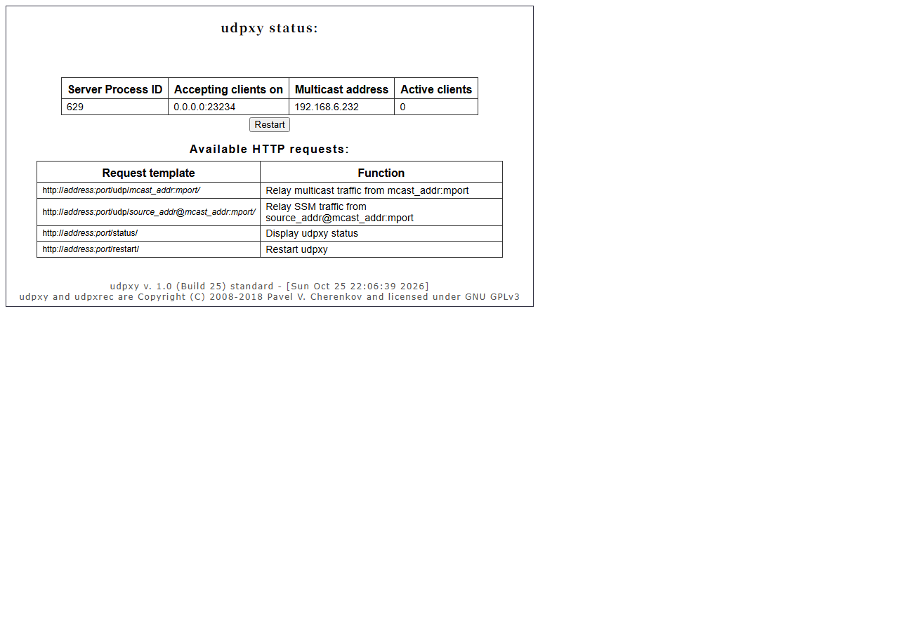

# 老毛子（Padavan）固件 IPTV 配置教程

> 测试环境：小米路由器 mini（RT-AC54U-GPIO-30-xiaomimini-128M），Padavan 固件 3.4.3.9-099_26-03-1，2026-10-25

按本文配置完成后，局域网里的电脑、手机、电视盒子都能通过 `http://192.168.123.1:23234/udp/组播地址:端口` 观看运营商的 IPTV 直播；Wi-Fi 下也能流畅播放。

## 一、原理与准备

运营商 IPTV 直播用的是**组播（Multicast）**。路由器需要完成三件事：

1. **IGMP 代理（igmpproxy）**：从外网口加入组播组，再把组播流转发到内网。
2. **udpxy**：把组播流转换成普通的 HTTP 单播流。这样手机、电脑、Wi-Fi 设备用任何播放器都能直接打开。
3. **IGMP 侦听 / 组播转单播（M2U）**：避免组播流灌满整个局域网，尤其是无线网。

准备工作：

- 路由器 WAN 口要能收到 IPTV 组播。本例中 mini 的 WAN 口接在光猫（或上级路由）的 LAN 口下，通过 DHCP 拿到 `192.168.6.x` 地址，上游已经放通了组播。
- 一份 IPTV 频道列表，里面是 `组播地址:端口`，例如 `239.x.x.x:5140`。可以从网上找本地区的列表，也可以在光猫抓包获取。
- 一个播放器：电脑用 VLC 或 PotPlayer，电视或盒子用 TVBox、DIYP、Kodi 等。

## 二、登录路由器后台

浏览器打开 `http://192.168.123.1`，输入管理账号密码（默认是 admin / admin）。

## 四、IPTV 设置（核心）

进入 **高级设置 → 内部网络 (LAN) → IPTV**，按下图设置后点击 **应用本页面设置**。



| 设置项 | 取值 | 说明 |
| --- | --- | --- |
| 启用组播路由到内网 | 开 | 启动 igmpproxy，把组播从 WAN 转发到内网 |
| 实现快速频道切换 | 是 | 即 IGMP quickleave，换台更快 |
| 强制 IGMP 协议版本 | 否 | 保持自动 |
| UDP 代理 (Udpxy) | `23234` | udpxy 监听的端口，填 0 表示关闭 |
| 可扩展的 UPnP 代理 (xUPNPd) | `0` | 不需要可以关闭 |
| 启用 IGMP/MLD 侦听 | 开 | 防止组播淹没整个局域网 |
| M2U - 以太网交换机 | HW IGMP/MLD snooping | 有线口用硬件侦听 |
| M2U - 无线 2.4GHz / 5GHz | Multicast to Unicast | 无线下组播转单播，避免卡顿 |

应用后，可以通过 SSH 确认两个服务都已运行：

```sh
ps | grep -E "udpxy|igmpproxy"
# /usr/sbin/udpxy -m eth2.2 -p 23234 -B 65536 -c 10 -M
# /bin/igmpproxy /etc/igmpproxy.conf
```

## 五、验证 udpxy

浏览器打开 `http://192.168.123.1:23234/status`，能看到 udpxy 状态页就说明服务正常。上面的截图中，组播来源接口的地址是 WAN 口的 192.168.6.232，当前活跃客户端数为 0。



## 六、客户端播放

播放地址格式：

```
http://192.168.123.1:23234/udp/组播地址:端口
```

例如组播地址是 `239.3.1.1:8000`，播放地址就是 `http://192.168.123.1:23234/udp/239.3.1.1:8000`。

**VLC / PotPlayer**：选择“打开网络串流”，粘贴上面的地址即可播放。

**m3u 播放列表**：把频道列表批量改成上面的格式，保存成 `iptv.m3u`，再导入电视盒子的播放器：

```
#EXTM3U
#EXTINF:-1,CCTV-1
http://192.168.123.1:23234/udp/239.3.1.1:8000
#EXTINF:-1,CCTV-2
http://192.168.123.1:23234/udp/239.3.1.2:8000
```

（上面的组播地址只是示例，请换成你所在地区运营商的实际地址。）

## 七、常见问题

| 现象 | 排查方法 |
| --- | --- |
| 打不开 status 页 | 确认 udpxy 端口不是 0，且进程在运行；默认只允许局域网访问 |
| status 正常但播放没画面 | 组播没进 WAN 口：检查光猫是否放通组播、IGMP 代理是否开启、组播地址是否正确 |
| 能播几秒后断流 | 上游 IGMP 查询超时，可以尝试把“强制 IGMP 协议版本”改为 IGMPv2 |
| Wi-Fi 下卡顿、拖慢全网 | 确认无线的 M2U 设为 Multicast to Unicast，并开启 IGMP 侦听 |
| 想在外网观看 | udpxy 默认不对外开放，需要在 WAN 防火墙放行 23234 端口，注意安全风险 |
| 同时观看人数受限 | udpxy 默认最多 10 个客户端（`-c 10`） |
